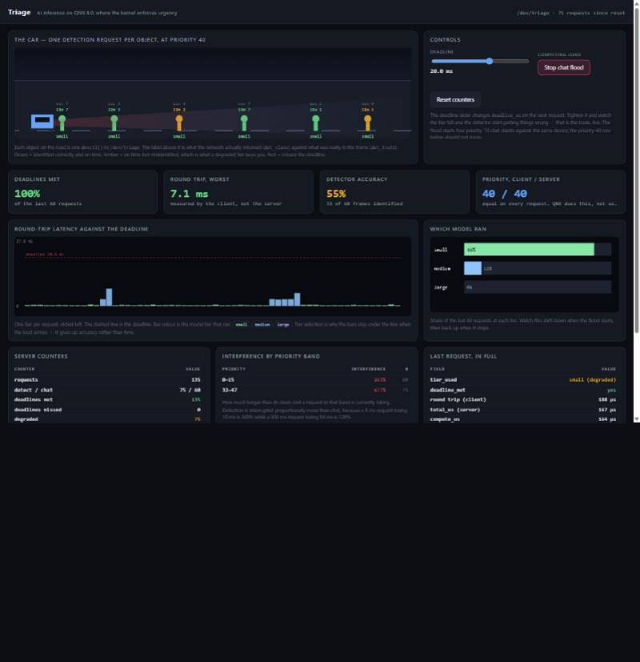

# Triage

**An AI inference service for QNX 8.0 where the operating system enforces urgency.**

Every request to Triage carries a priority and a deadline. A life-critical
question — *"is that a pedestrian?"* — preempts a chatbot question
mid-computation and still answers on time.

> Robots are getting AI brains. Triage makes sure the urgent thought gets
> the CPU first.

---

## The problem

A robot or a car has one AI brain and many askers. The brake controller
asks "is that a person?" while the voice assistant asks "what's the
weather?" Standard inference servers — llama.cpp's server, Triton, every
HTTP model endpoint — serve requests first come, first served. They have
no idea that one of those questions has 20 milliseconds to live and the
other has two seconds.

QNX's own 2026 survey of 1,000 robotics developers found that 89% consider
physical AI critical, while only 29% feel confident they can make safe,
predictable decisions in the real world. That gap is a scheduling problem
wearing an AI costume.

## The approach

Triage is not a priority queue bolted onto an inference server. It is a
**QNX resource manager**, and it leans on something the microkernel
already does.

When a client calls `devctl()` on `/dev/triage`, QNX turns it into a
`MsgSend()` and the server thread that receives it **runs at the priority
of the calling thread**. We do not set that priority. We do not look it
up. We could not prevent it if we tried. It is what the kernel does with a
synchronous message on a channel created without `_NTO_CHF_FIXED_PRIORITY`.

So the brake controller's question is not *tagged* urgent — inside Triage
it **is** priority-40 work, and the kernel will take the CPU away from the
chat inference running at priority 10 to do it. Urgency crosses the process
boundary for free.

On top of that, Triage adds the part the OS cannot know: **how much AI to
run.** Each request states its deadline, and Triage picks the largest model
tier whose measured cost still fits — a rough answer on time rather than a
perfect answer too late.

## Status

Stage 1 of 5. This is a hackathon project in progress (QNX Global
Hackathon, submission 14 Dec 2026).

| Piece | State |
|---|---|
| `/dev/triage` resource manager, thread pool, devctl protocol | built |
| Client library with priority + deadline | built |
| Chunked compute with preemption accounting | built |
| Deadline-driven tier selection, cost + interference model | built |
| Text stats / counters | built |
| Real inference backend | **DETECT is real** (trained MLPs, `server/nn.c`); CHAT still a calibrated load |
| Boots on QNX 8.0 under QEMU, smoke test green | verified 14 Nov |
| Priority inheritance verified on target | 100/100 requests, asserted in code |
| First-come-first-served baseline server for comparison | built, measured |
| Car sim + web dashboard | **built**, served by the target itself — [`dashboard/`](dashboard/) |
| CPU budget protection | **built** on SCHED_SPORADIC, kernel-enforced and verified; end-to-end effect not yet measurable on QEMU |
| Codelab: build it yourself, with programs that run | **built**, 6/6 checks green on target — [`codelab/`](codelab/) |
| Benchmark numbers on hardware | QEMU done — see [benchmark.md](docs/benchmark.md); bare metal still owed |

Detection runs a real neural network. Three MLPs trained on MNIST
([`tools/train_detector.py`](tools/train_detector.py)) are compiled into
the server and scanned over a frame as a sliding window, so a tier is a
network plus a scan density:

| tier | MNIST accuracy | windows | measured cost on target |
|---|---|---|---|
| small | 93.2% | 81 | 162 us |
| medium | 96.3% | 324 | 2.59 ms |
| large | 97.8% | 1225 | 30.6 ms |

Those costs are measured at startup, not declared, and `confidence` in
every reply is the tier's measured test accuracy rather than a number
someone typed. **Chat** has no model yet and is still a calibrated load.

### What the deadline trade actually costs

60 frames per row, priority 40, measured on the QNX target:

| deadline | deadlines met | mean latency | detection accuracy |
|---|---|---|---|
| 200 ms | 100% | 12.5 ms | **78.3%** |
| 20 ms | 100% | 1.3 ms | 58.3% |
| 5 ms | 100% | 375 us | 51.7% |
| 1 ms | 95% | 460 us | 51.7% |

Tighten the deadline 200-fold and latency falls 27-fold while accuracy
drops from 78% to 52% — and the deadlines keep being met. Under a flood of
four greedy chat clients at a 20 ms deadline: 60/60 met, 60.0% accurate.
That is "a rough answer on time beats a perfect answer too late", with a
price tag on it.

The detector is real inference; it is not a pedestrian detector. A 14x14
MLP on digits stands in for the vision model a shipping system would run.
What is no longer standing in is the arithmetic, the cost, the chunk
granularity, or the accuracy. [`docs/architecture.md`](docs/architecture.md)
has the three bugs it took to get there.

## Build

Needs **QNX SDP 8.0** and its toolchain on `PATH`.

The trained detector is committed as `server/nn_weights.h`, so building
needs no Python and no dataset. To retrain it:

```bash
python tools/train_detector.py --mnist <dir-with-mnist-idx-files>
```

```bash
source ~/qnx800/qnxsdp-env.sh
make info          # confirms qcc is found
make               # builds for x86_64 (the QEMU target)
make stage         # collects binaries into stage/x86_64/
```

For a Raspberry Pi 4/5 target:

```bash
make ARCH=aarch64le stage
```

### Building from Windows via WSL2

SDP 8.0's `qnxsdp-env.sh` does not export into non-interactive shells, so
driving the build from Windows needs the environment set explicitly.
[`scripts/wsl-build.sh`](scripts/wsl-build.sh) does that:

```bash
wsl -d Ubuntu -- bash scripts/wsl-build.sh
wsl -d Ubuntu -- bash scripts/wsl-build.sh ARCH=aarch64le
```

[`scripts/wsl-env.sh`](scripts/wsl-env.sh) runs any SDP command the same
way — `mkqnximage`, `qcc`, `mkifs`:

```bash
wsl -d Ubuntu -- bash scripts/wsl-env.sh mkqnximage --help
```

Booting a QEMU target also needs QEMU itself, which SDP does not install.
Once, as root:

```bash
wsl -d Ubuntu -- sudo bash scripts/wsl-deps.sh
```

## Run

Build and boot a QNX 8.0 QEMU image with the binaries inside it:

```bash
./scripts/qemu.sh build
./scripts/qemu.sh run
./scripts/qemu.sh ssh
```

Then, on the target:

```bash
cd /data
./smoke.sh
```

`smoke.sh` is the proof-of-life script, and all four of its steps are
assertions rather than output for a human to judge: that `/dev/triage` was
created, that requests are answered, that the server ran the work at the
*client's* priority, and that high-priority deadlines survive a
low-priority flood.

### What it currently reports

First on-target run, QNX 8.0 x86_64 under QEMU, one CPU
([full output](docs/smoke-x86_64.txt)):

| | |
|---|---|
| Priority inherited | **100% of requests**, at priority 40 and at 12 |
| Deadlines met, best run | **183 / 183 (100%)** |
| Deadlines met, across runs | 92%, 95%, 99%, 100% |
| CPU stolen by interference | up to 3.76 s over 1061 preemptions |

Two things about those numbers, because they are easy to overstate.

The spread is the host, not Triage. QEMU on a Windows laptop deschedules
the guest at random: with *nothing competing*, 24 of 40 requests still lose
CPU. That theft is invisible to QNX and comparable in size to the 20 ms
deadline, so the smoke test's flood step is a regression tripwire rather
than a claim. Priority inheritance is the part that is claimed outright,
because it is asserted on every single request and has never once failed.

An earlier version of the engine reported a clean 100% and it was an
artifact: it burned wall-clock time instead of doing work, so a preempted
request quietly did less and still finished "on time". Fixing that dropped
the figure to 92%; modelling interference in tier selection brought it back
up honestly. [`docs/architecture.md`](docs/architecture.md) has both
post-mortems.

To drive it by hand:

```bash
./triage -v &                              # the service
./brake_reflex -P 40 -d 20000 -p 50000     # urgent client, 20ms deadline
./chat_load -n 4 -P 10 -s 30               # four greedy chat clients
./triage_stat -w 1                         # counters, once a second
```

Raising a thread's priority needs the `PROCMGR_AID_PRIORITY` ability, so
run the demos as root on a stock image.

## Does it actually beat a normal inference server?

Yes, and by how much is measured rather than asserted:
[`docs/benchmark.md`](docs/benchmark.md).

[`bench/fcfs.c`](bench/fcfs.c) is a first-come-first-served baseline built
to be the strongest *honest* version of the conventional approach — same
engine, same transport, same protocol, same thread pool, same clients, same
boot. The differences are deliberate and enumerated; the headline one is
that its channel is created **with** `_NTO_CHF_FIXED_PRIORITY`, the single
flag Triage omits, so its threads run at the server's priority instead of
the caller's.

150 detection requests, priority 40, 20 ms deadline, under a four-thread
chat flood, as load intensity rises. **Every latency is timed by the
client, around its own `devctl`**, so it includes everything the server
made it wait for:

| deadline hit rate | load 300 | load 500 | load 800 |
|---|---|---|---|
| **Triage** | **100%** | **100%** | **100%** |
| FCFS queue, Triage's own tiers | 80% | 87% | 92% |
| FCFS queue, medium tier | 49% | 67% | 79% |
| same pool + tier, no inheritance | 27% | 25% | 39% |

And the number that matters more than the average — worst case against a
20 ms deadline:

| | load 300 | load 500 | load 800 |
|---|---|---|---|
| **Triage** | **16.1 ms** | **3.4 ms** | **12.1 ms** |
| same pool + tier, no inheritance | 114 ms | 116 ms | 62 ms |
| FCFS queue, medium tier | 398 ms | 737 ms | 931 ms |
| FCFS queue, Triage's own tiers | 874 ms | 1362 ms | **2236 ms** |

Mean latency over the same runs: **0.4–4 ms for Triage against 36–151 ms**
for every baseline.

Four readings. **One flag is worth 61–75 points** — that middle row is the
same pool, same tier, same everything, differing only in
`_NTO_CHF_FIXED_PRIORITY`. **First-come-first-served has a tail 14–112×
over the deadline** that no tuning removes, since a detection request
queued behind several 300 ms chat requests waits for all of them. **The win
is not a smaller model**: Triage still wins when the baseline is handed its
own tier choices. And **concurrency without priority makes things worse** —
a thread pool multiplies the work competing with an urgent request, which
is why the no-inheritance pool has the worst hit rate of any baseline
despite having the best tail.

This is the **second** run of this benchmark. The first is superseded: the
server was serialising its own handlers on a lock the resource manager
framework installs, and every latency it reported came from its own clock,
which starts after the wait. The benchmark doc records that, the two
changes made to the *baseline* that cost Triage points, and the three ways
an earlier version of the comparison was wrong — including a baseline that
accidentally inherited priority and therefore "beat" Triage.

## Evidence of QNX use

Triage is not a portable program with a QNX build target. It cannot be
written on Linux — the mechanism it is built on does not exist there.

| QNX feature | Where | What it does for us |
|---|---|---|
| **Resource manager** | `resmgr_attach()` in [`server/main.c`](server/main.c) `main()` | Creates `/dev/triage`. The AI becomes a device any process can open. |
| **Native message passing** | `devctl()` in [`client/libtriage.c`](client/libtriage.c) `triage_infer()`, received by `io_devctl()` in [`server/main.c`](server/main.c) | Request and reply with no broker, no socket, no serialisation. |
| **Priority inheritance** | `ctp->info.priority` vs `pthread_getschedparam()` in `io_devctl()`, [`server/main.c`](server/main.c) | The core of the project. Both numbers are reported in every reply, so the inheritance is observable from the client, not just asserted in a README. |
| **Channel semantics** | `dispatch_create()` in `main()`, deliberately *without* `_NTO_CHF_FIXED_PRIORITY` | The one line that makes inheritance happen. There is a comment there telling future contributors not to "fix" it. |
| **Thread pool** | `thread_pool_create()` in `main()` | Inheritance only buys anything if an urgent message can be received while a lazy request is still computing. |
| **Real NN inference, chunked** | `nn_scan_step()` in [`server/nn.c`](server/nn.c), driven by `engine_run_chunk()` | A chunk is a batch of sliding windows sized to ~2 ms, so inference can stop between any two windows and still answer with the best detection so far. This is what makes a deadline able to *degrade* the model rather than just preempt it. |
| **Cycle-accurate timing** | `ClockCycles()` and `SYSPAGE_ENTRY(qtime)->cycles_per_sec` in [`server/engine.c`](server/engine.c) | Microsecond measurement without syscall overhead in the measurement path. |
| **CPU budget enforcement** | `SCHED_SPORADIC` in [`server/budget.c`](server/budget.c) `budget_apply()` | A kernel-enforced CPU ceiling on low-priority AI. Verified enforced by [`bench/sched_probe.c`](bench/sched_probe.c): 16.5% of CPU against ~100% unenforced. |
| **The target serves its own UI** | `socket()`/`accept()` in [`dashboard/triage_web.c`](dashboard/triage_web.c), with a priority-40 client thread in the same process | The dashboard is a Triage client, not a log scraper. Everything the browser draws came back in a `triage_reply_t` over `devctl()`. |
| **Unserialised handlers** | `io_funcs.lock_ocb = NULL` in `main()` | The framework locks the shared device attribute around every I/O message by default, which serialises the thread pool and quietly defeats the whole design. Clearing it is what makes concurrency real; see [`docs/architecture.md`](docs/architecture.md). |
| **Client unblock handling** | `io_unblock()` in [`server/main.c`](server/main.c) with [`server/cancel.c`](server/cancel.c) | A killed client's request stops at the next chunk instead of burning a whole tier of CPU at the dead client's inherited priority. |
| **Fixed-priority channel** | `ChannelCreate(_NTO_CHF_FIXED_PRIORITY ...)` in [`bench/fcfs.c`](bench/fcfs.c) `main()` | The baseline, built by setting the one flag Triage omits. It is how the benchmark isolates inheritance as a single variable. |
| **Deferred reply** | `_RESMGR_NOREPLY` in `io_devctl()` and `MsgReply()` in `worker()`, [`bench/fcfs.c`](bench/fcfs.c) | Lets the baseline implement a real FCFS queue: receive now, reply later from another thread, in arrival order. QNX would otherwise deliver the highest-priority message first. |

> **Update, 16 Nov:** the replacement is settled. `SCHED_SPORADIC` is
> verified working and kernel-**enforced** on QNX 8.0 by
> [`bench/sched_probe.c`](bench/sched_probe.c) — a sporadic thread with a
> 2 ms/10 ms budget got 16.5% of the CPU where an unenforced one would have
> taken ~100%. That is a stronger ceiling than the token-bucket fallback,
> because the kernel can take the CPU away from work already running.
> Wiring it into the request path is the remaining step.

> **Note on Adaptive Partitioning.** The original design used QNX Adaptive
> Partitioning for this. It cannot: **APS was discontinued in QNX SDP 8.0**
> and QNX OS 8.0 does not support it. `mkqnximage` on SDP 8.0 offers no
> partitioning option, and the QoS packages are not available under the
> non-commercial licence. The budget ceiling is therefore being rebuilt on
> what 8.0 does have — see [`docs/architecture.md`](docs/architecture.md).

Every reply contains `client_prio` and `server_prio`
([`common/triage_proto.h`](common/triage_proto.h)). Run `./brake_reflex -P 40`
and then `./brake_reflex -P 12` and watch both numbers move together.
That is the mechanism, visible from userspace, in one command.

## Repository layout

```
common/     wire protocol shared by client and server
server/     the resource manager, the chunked engine, the tier scheduler
client/     the client library: three functions, one header
demo/       urgent client, greedy client, counters
bench/      FCFS baseline server and benchmark harness
dashboard/  the live UI, and the HTTP server on the target that feeds it
codelab/    the tutorial, with three step programs that build and run
docs/       architecture notes and the benchmark
tools/      trains the detector and generates server/nn_weights.h
scripts/    QEMU image build, on-target smoke test
```

## The dashboard



```bash
make stage && ./scripts/qemu.sh dash     # then open http://localhost:8088/
```

[`dashboard/triage_web.c`](dashboard/triage_web.c) runs **on the QNX
target** and is two things at once: a priority-40 client that asks
`/dev/triage` "what is in this frame?" on a period with a deadline, and a
small HTTP server that hands the replies to a browser as JSON. One
process, because the point is that everything on screen is a real reply
from a real resource manager — the only simulated thing is where the car
is drawn, and even that is driven by the replies.

Every value the page shows is a field of `triage_reply_t`: the two
priorities, which tier ran, whether it was on time, what the detector saw
against the frame's ground truth, and what the tier decision was made on.
The round trip is timed **in the client, around the `devctl`**, not taken
from the server's own `total_us` — see
[`docs/architecture.md`](docs/architecture.md) for the weeks that
distinction cost.

Two controls make it a demo rather than a readout. The deadline slider
changes `deadline_us` live, and the trade happens in front of you:

| deadline | tier chosen | detector accuracy | worst round trip | deadlines met |
|---|---|---|---|---|
| 2 s | 100% large | 83% | 89 ms | 100% |
| 20 ms | 77% small | 55% | 9.6 ms | 100% |

The other starts four priority-10 chat clients against the same device.
The priority-40 row does not move — which is the whole project, visible
in one click.

## Codelab

[`codelab/`](codelab/README.md) builds this from nothing in three steps —
a 70-line resource manager, the priority-inheritance experiment and the
flag that turns it off, and the two things that make inheritance actually
land — then walks the six pieces the real service adds. Its three step
programs build standalone (`make -C codelab`) and
[`codelab/verify.sh`](codelab/verify.sh) asserts every claim it makes, on
your target.

It also found a real bug in this project, which is written up in both
places: the resource manager was serialising its own handlers on the lock
`iofunc_func_init()` installs, and the server's own latency clock could
not see it.

## Design notes

[`docs/architecture.md`](docs/architecture.md) covers why preemption is the
kernel's job and not ours, what the chunk loop is actually for, how the
cost model adapts, and which claims we have not earned yet.

## License

MIT — see [LICENSE](LICENSE).
